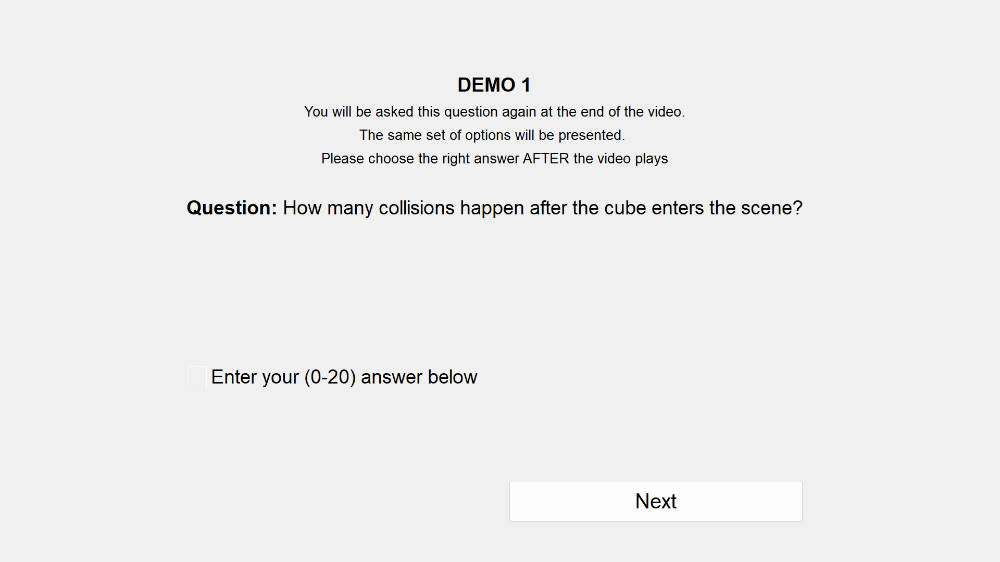
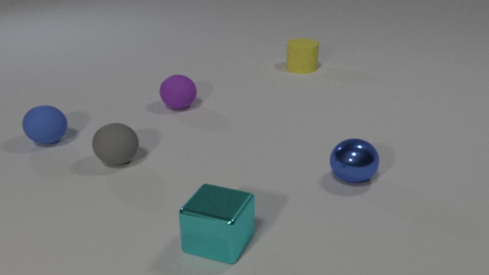
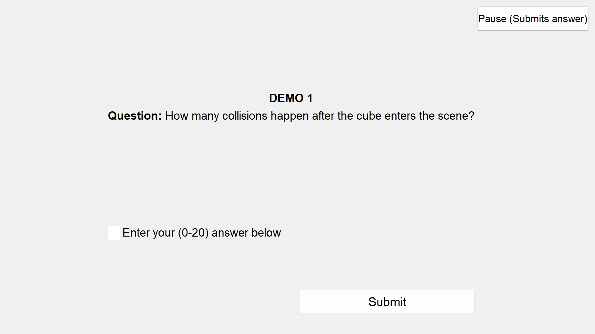
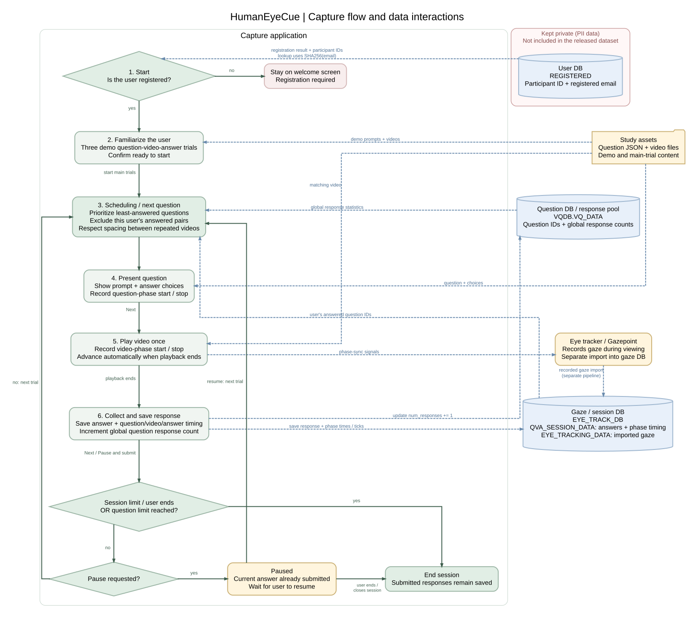

# HumanEyeCue eye-tracking capture

## Introduction

This codebase contains the GUI and backend for the HumanEyeCue eye-tracking project. Written in Python using OpenCV and PyQt, it presents a question, plays the video once, and collects the participant's answer. Session timing and responses are stored in MySQL; Gazepoint records gaze separately. The database's Docker configuration is included.

| Read the question | Watch the video | Submit an answer |
| --- | --- | --- |
|  |  |  |



Diagram source: [architecture.dot](architecture.dot); render with `dot -Tsvg architecture.dot -o architecture.svg`. Dashed arrows follow data flow: assets and database reads enter the app; saved responses and count updates leave it. The source prepares the schedule at login and consumes it after demos, with a 120-question cap. Session-limit termination is conceptual: the current code has no automatic time-limit timer. Pause submits the current answer before waiting for resume.

## External dependencies

1. Gazepoint EyeTracker and Gazepoint Analysis for collecting gaze data.
2. MySQL for storing participant sessions and responses.
3. Python (the original code was tested with Python 3.9) and Docker.

Other eye trackers can be used, but their integration needs to replace `create_project_for_user_and_open_gp` in `pyUI/start_screen.py` and supply compatible gaze exports.

## Usage

From this `capture` directory, create a Python environment, then:

```powershell
python -m pip install -r requirements.txt
Copy-Item config.example.json config.json
$env:HUMANEYECUE_DB_DATA_PATH = 'C:/path/to/Database'
$env:HUMANEYECUE_DB_ROOT_PASSWORD = '<choose a local password>'
$env:HUMANEYECUE_DB_PASSWORD = $env:HUMANEYECUE_DB_ROOT_PASSWORD
docker compose up -d
python app.py
```

Set `HUMANEYECUE_DB_DATA_PATH` to an existing absolute directory for MySQL storage, using forward slashes on Windows. This host-directory mount matches the original deployment structure without including a personal path. Docker initializes empty tables only when the directory is empty.

Before launching, update `config.json`: `question_root_path` must contain `qa_all_selected_with_demo.json` and `video_all_selected/`; `root_path` must contain the Gazepoint template `template/NewProject.prj`. Register participants in `EYE_TRACK_DB.REGISTERED` and populate the schedule in `VQDB.VQ_DATA`.

Participants registered through Microsoft Forms. Once a participant was approved, a Python script inserted their registration details into the private user database (`REGISTERED`).

Participants enter their registered email, complete three practice trials, then confirm they are ready to start. Each main trial presents the question, plays the video once, and records the answer and phase timing. **Pause** submits the current answer before pausing; resuming continues to the next question. Practice answers are not stored.

The user database includes participants' email addresses (`email`), first names (`first_name`), and last names (`last_name`). These registration details identify participants and should be handled with care. The user database and registration spreadsheet are kept private and are not included in the released dataset. Trial records use a hashed identifier rather than the email address. Keep participant records, local configuration, recordings, and database storage outside version control.

## Build the Windows app

Run from this `capture` directory on Windows:

```powershell
python -m pip install -r requirements-build.txt
python -m PyInstaller --clean --noconfirm app.spec
Copy-Item config.example.json dist/HumanEyeCueCapture/config.json
```

The build produces `dist/HumanEyeCueCapture/HumanEyeCueCapture.exe` with its UI files, icons and Python dependencies. Edit the adjacent `config.json` and set the database password environment variables as above before launching. Distribute the entire `HumanEyeCueCapture` folder. MySQL, Gazepoint, study assets and participant records remain external; local configuration and credentials are not bundled by the build.
